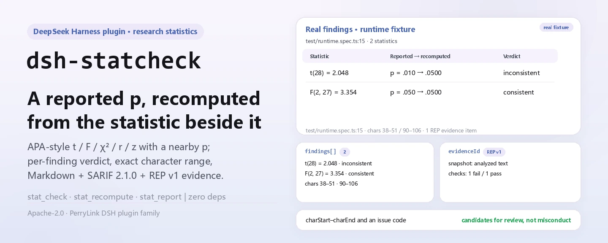
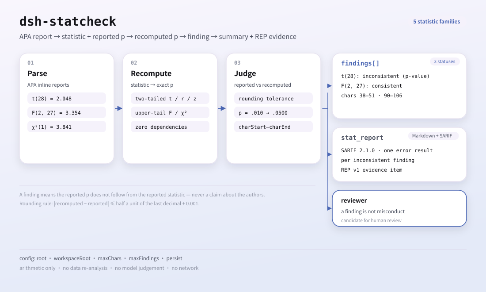
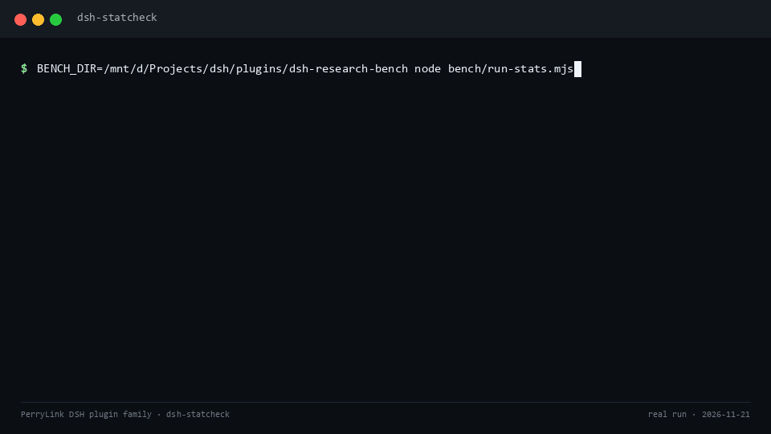

<div align="center">

<picture>
  <source media="(prefers-color-scheme: dark)" srcset="docs/assets/dsh-statcheck-hero-en-dark.webp">
  
</picture>

# dsh-statcheck

**Recalcula las estadísticas que reporta un manuscrito — y marca las que no cuadran.**

*Es aritmética, no acusación: cada hallazgo muestra la estadística reportada, el valor p que realmente implica y los caracteres exactos de los que proviene.*

[English](README.md) · [简体中文](README-zh.md) · [Español](README-es.md) · [Português](README-pt.md) · [हिन्दी](README-hi.md)

[](LICENSE)
[]()

</div>

---

## Qué hace

- Analiza informes de estilo APA: `t(df)`, `F(df1, df2)`, `χ²(df)`, `r(df)`, `z`, cada uno con un `p = …`, `p < …` o `p > …` cercano y un `95% CI [lo, hi]` opcional.
- Recalcula el valor p a partir de la estadística reportada con distribuciones sin dependencias (t/r/z de dos colas, F/χ² de cola superior).
- Marca la autocontradicción con el valor reportado, el valor recalculado, el intervalo de caracteres y un código de incidencia estable.
- Comprueba el CI frente a la significación (un p significativo con un CI que incluye 0 es una contradicción).
- Emite Markdown y **SARIF 2.1.0**, y registra el texto analizado como un elemento de evidencia REP v1 cuyas comprobaciones son los hallazgos.

<picture>
  <source media="(prefers-color-scheme: dark)" srcset="docs/assets/dsh-statcheck-flow-v5-dark.svg">
  
</picture>

*Estructura: analizar → recalcular → juzgar; `findings[]` y `summary` son las dos salidas, y `stat_report` las renderiza como Markdown y SARIF 2.1.0. Las etiquetas de token dentro del diagrama son los nombres reales de herramientas, comprobaciones e incidencias, así que la misma imagen sirve para los cinco idiomas.*

## Qué no hace

- **Sin reanálisis de datos.** No puede saber si la estadística reportada es apropiada para el diseño.
- **Sin acusaciones de mala conducta.** Un hallazgo significa «el p reportado no se sigue de la estadística reportada». Es un candidato para revisión humana, nunca un veredicto sobre los autores.
- **Sin PDF/OCR.** Extrae primero el texto (`dsh-doc-anchor`) y pasa `text` o una ruta `.txt/.md/.tex/.html`.
- **Sin comprobaciones de modelo o supuestos**, sin corrección por comparaciones múltiples, sin inferencia del tamaño de muestra.
- **Sin ampliación silenciosa de la tolerancia.** La regla de redondeo es fija y está documentada; un valor marcado sigue marcado.

## Compatibilidad

| | |
|---|---|
| DeepSeek Harness | **`dsh-v0.2.3-alpha.1`** (verificado 2026-11-22); línea peer `>=0.2.1-0 <0.3.0 \|\| >=0.2.2-0 <0.3.0` |
| Node | `^22.19.0 \|\| >=24.9.0` (probado en `24.22.1`), solo ESM |
| Peers | `@perrylink/dsh-research-core ^0.1.0`, `@deepseek-ai/cordis ^4.0.5-alpha.1`, `@deepseek-ai/dsh-tools`, `@deepseek-ai/schemastery ^3.18.5-alpha.1` |
| Dependencias en tiempo de ejecución | **cero** |

```sh
dsh plugin --profile <name> add @perrylink/dsh-research-core dsh-statcheck
dsh --profile <name> --dump-config | grep dsh-statcheck
dsh plugin --profile <name> remove dsh-statcheck
```

## Herramientas

### `stat_check`

`{ text?, path?, persist?, maxFindings? }` → `{ ok, summary, findings[], source, evidenceId?, recordPath? }`.

Cada hallazgo: `statistic`, `df`, `text`, `charStart`, `charEnd`, `reported { statistic, p, pKind, pValue, ci? }`, `recomputed { p }`, `status` (`consistent`/`inconsistent`/`unparsed`), `issue?` (`p-value`/`p-threshold`/`ci`/`format`/`df`), `severity`, `detail`.

### `stat_recompute`

`{ statistic: 't'|'F'|'chi2'|'r'|'z', value, df[], p? }` → `{ ok, p, judgment? }`.
t/r/z son de dos colas; F/χ² de cola superior. `p` usa la misma regla de redondeo que `stat_check`.

### `stat_report`

`{ findings, text? }` → `{ ok, markdown, sarif, summary }`. SARIF lleva un resultado de error por cada hallazgo inconsistente. Pasa el texto original del manuscrito para mapear el `charStart` de cada hallazgo a un `startLine`/`startColumn` real de SARIF; sin `text`, la región cae en la línea 1 más una columna de carácter (las propiedades `charStart`/`charEnd` siempre son exactas).

### Códigos de error

`INVALID_INPUT` · `NOT_FOUND` · `PATH_ESCAPE` · `NOT_A_FILE` · `TOO_LARGE` · `OUT_OF_DOMAIN` · `STORE_ERROR`

## La regla de redondeo (documentada, no ajustada)

Un `p = x` reportado es consistente cuando `|recalculado − x| ≤ 0.5 × 10^-decimales + 0.001`.
El `0.001` extra absorbe el hecho de que la estadística en sí suele reportarse redondeada (p. ej. `t = 2.50` implica p ≈ .01855, que suele escribirse `.019`). `p < X` es consistente cuando el valor recalculado está por debajo de `X`; `p > X` cuando está por encima.

## Configuración

| Clave | Predeterminado | Significado |
|---|---|---|
| `enabled` | `true` | `false` no monta nada |
| `root` | `.statcheck` | raíz del almacén y de los registros |
| `workspaceRoot` | `process.cwd()` | las rutas de manuscritos deben resolverse dentro de ella |
| `maxChars` | `2000000` | límite de caracteres analizados (por encima falla, nunca trunca) |
| `maxFindings` | `500` | hallazgos por llamada |
| `persist` | `true` | guarda una instantánea y un registro REP |

## Evaluación



*Animado: la salida real por stdout del adaptador de benchmark sobre los 30 casos de estadística congelados (`node bench/run-stats.mjs` con `BENCH_DIR` apuntando al checkout congelado de `dsh-research-bench`, sin red; reejecutado el 2026-11-21). Las puntuaciones perfectas describen solo estos casos construidos alrededor de valores críticos — la advertencia de alcance de abajo sigue aplicando.*

### Benchmark — `dsh-research-bench` stats v0.1.0 (30 casos)

```sh
pnpm run bench:stats
```

| métrica | valor |
|---|---:|
| precision de inconsistencia | **1.00** |
| recall de inconsistencia | **1.00** |
| F1 de inconsistencia | **1.00** |
| tasa de falsos positivos en muestras limpias | **0.00** |
| exactitud de la incidencia al marcar | **1.00** |
| exactitud global | **1.00** |

Predicciones sin procesar por caso: [`bench/results-stats.json`](bench/results-stats.json).

**Advertencia de alcance**: el conjunto de datos es pequeño, sintético y limpio (10 frases consistentes + 20 inconsistentes construidas alrededor de valores críticos publicados). Una puntuación perfecta muestra que el analizador y el recálculo coinciden con las etiquetas de valor crítico en estas construcciones; **no** estima la exactitud sobre manuscritos reales. La regla de redondeo y los códigos de incidencia están documentados para que un lector pueda discrepar de un hallazgo concreto.

### Pruebas

- **43 pruebas en 6 archivos**: colas de distribución frente a valores críticos publicados (t/F/χ²/r/z), análisis (todas las familias, desplazamientos, umbrales, CI, varias estadísticas, no analizado), juicio (p-value, umbral, formato, CI, df, dominios negativos de F/χ²), runtime (evidencia + registro REP válido, reverificación sin conflicto de evidencia, tope de hallazgos, tipo de archivo/media, persist=false, escapes de ruta, límite de tamaño), herramientas (esquemas, éxito/fallo, SARIF incl. un p recalculado nulo y el mapeo de línea/columna desde el texto opcional) y contrato del paquete.

## Limitaciones conocidas (v0.1)

- No se modelan pruebas de una cola, df fraccionarios de Welch, tablas multi-modelo ni referencias dentro del texto como «ver Tabla 2».
- Solo se analizan informes APA en línea; los valores `p` en tablas quedan fuera de alcance.
- La comprobación de CI frente a p asume una prueba bilateral del mismo efecto con α = .05.
- Sin corrección por comparaciones múltiples.
- El mapeo de línea/columna de SARIF necesita el `text` opcional de `stat_report`; sin él, la región es línea 1 + columna de carácter (las propiedades exactas `charStart`/`charEnd` siempre están presentes).

## Licencia

Apache-2.0. Ningún código de terceros en tiempo de ejecución.
