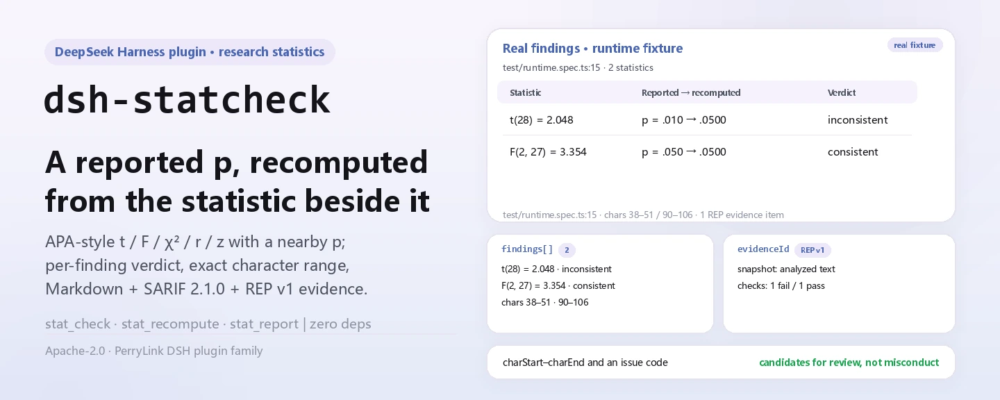
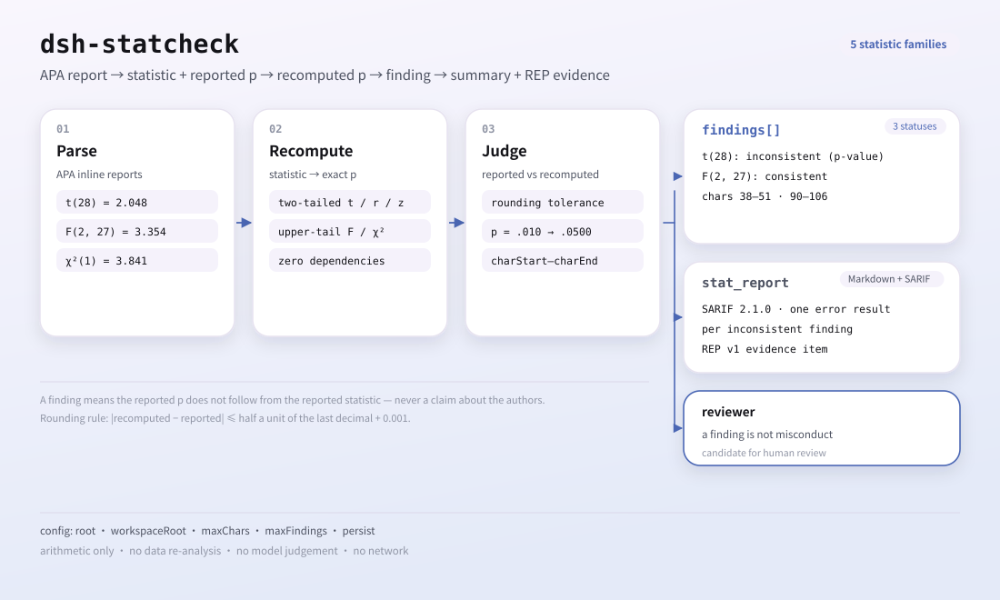
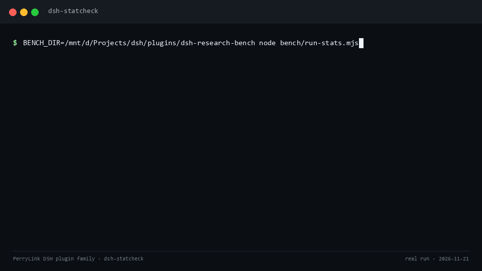

<div align="center">

<picture>
  <source media="(prefers-color-scheme: dark)" srcset="docs/assets/dsh-statcheck-hero-en-dark.webp">
  
</picture>

# dsh-statcheck

**एक पांडुलिपि में बताई गई सांख्यिकी को दोबारा गिनें — और जो मेल नहीं खातीं उन्हें चिह्नित करें।**

*यह अंकगणित है, आरोप नहीं: हर निष्कर्ष बताई गई सांख्यिकी, उससे वास्तव में निकलने वाला p मान और वह सटीक अक्षर-स्थान दिखाता है जहाँ से वह आया।*

[English](README.md) · [简体中文](README-zh.md) · [Español](README-es.md) · [Português](README-pt.md) · [हिन्दी](README-hi.md)

[](LICENSE)
[]()

</div>

---

## यह क्या करता है

- APA शैली के रिपोर्ट पढ़ता है: `t(df)`, `F(df1, df2)`, `χ²(df)`, `r(df)`, `z` — हर एक के पास `p = …`, `p < …` या `p > …` और वैकल्पिक `95% CI [lo, hi]`।
- बताई गई सांख्यिकी से शून्य-निर्भरता वाले वितरणों के साथ p मान दोबारा निकालता है (t/r/z दो-पुच्छीय, F/χ² ऊपरी-पुच्छ) ।
- बताए गए मान, दोबारा निकाले गए मान, अक्षर-सीमा और एक स्थिर issue कोड के साथ आत्म-विरोध चिह्नित करता है।
- CI की सार्थकता से तुलना करता है (सार्थक p के साथ ऐसा CI जिसमें 0 शामिल है, एक विरोध है)।
- Markdown और **SARIF 2.1.0** देता है, और विश्लेषित पाठ को REP v1 साक्ष्य आइटम के रूप में दर्ज करता है जिसकी जाँचें वही निष्कर्ष होती हैं।


<picture>
  <source media="(prefers-color-scheme: dark)" srcset="docs/assets/dsh-statcheck-flow-v5-dark.svg">
  
</picture>

*संरचना: पढ़ना → दोबारा गिनना → आँकना; `findings[]` और `summary` दो आउटपुट हैं, और `stat_report` उन्हें Markdown तथा SARIF 2.1.0 में प्रस्तुत करता है। आरेख के टोकन लेबल असली टूल, जाँच और issue नाम हैं, इसलिए वही चित्र पाँचों भाषाओं के लिए काम करता है।*

## यह क्या नहीं करता

- **डेटा का पुनर्विश्लेषण नहीं।** यह नहीं जान सकता कि बताई गई सांख्यिकी अध्ययन-रचना के लिए उपयुक्त है या नहीं।
- **दुराचरण का आरोप नहीं।** एक निष्कर्ष का अर्थ है “बताया गया p बताई गई सांख्यिकी से नहीं निकलता”। यह मानवीय समीक्षा का उम्मीदवार है, लेखकों पर कभी फैसला नहीं।
- **PDF/OCR नहीं।** पहले पाठ निकालें (`dsh-doc-anchor`) और `text` या `.txt/.md/.tex/.html` पथ दें।
- **मॉडल/मान्यता जाँच नहीं**, बहु-तुलना सुधार नहीं, नमूना-आकार अनुमान नहीं।
- **चुपचाप सहनशीलता बढ़ाना नहीं।** राउंडिंग नियम स्थिर और प्रलेखित है; चिह्नित मान चिह्नित ही रहता है।

## संगतता

| | |
|---|---|
| DeepSeek Harness | **`dsh-v0.2.2-rc.4`** (2026-11-18 को सत्यापित); peer पंक्ति `>=0.2.1-0 <0.3.0 \|\| >=0.2.2-0 <0.3.0` |
| Node | `^22.19.0 \|\| >=24.9.0` (`24.22.1` पर परखा गया), केवल ESM |
| Peers | `@perrylink/dsh-research-core ^0.1.0`, `@deepseek-ai/cordis ^4.0.5-alpha.1`, `@deepseek-ai/dsh-tools`, `@deepseek-ai/schemastery ^3.18.5-alpha.1` |
| रनटाइम निर्भरताएँ | **शून्य** |

```sh
dsh plugin --profile <name> add @perrylink/dsh-research-core dsh-statcheck
dsh --profile <name> --dump-config | grep dsh-statcheck
dsh plugin --profile <name> remove dsh-statcheck
```

## टूल

### `stat_check`

`{ text?, path?, persist?, maxFindings? }` → `{ ok, summary, findings[], source, evidenceId?, recordPath? }`.

हर निष्कर्ष: `statistic`, `df`, `text`, `charStart`, `charEnd`, `reported { statistic, p, pKind, pValue, ci? }`, `recomputed { p }`, `status` (`consistent`/`inconsistent`/`unparsed`), `issue?` (`p-value`/`p-threshold`/`ci`/`format`/`df`), `severity`, `detail`.

### `stat_recompute`

`{ statistic: 't'|'F'|'chi2'|'r'|'z', value, df[], p? }` → `{ ok, p, judgment? }`.
t/r/z दो-पुच्छीय हैं; F/χ² ऊपरी-पुच्छ। `p` वही राउंडिंग नियम उपयोग करता है जो `stat_check` करता है।

### `stat_report`

`{ findings, text? }` → `{ ok, markdown, sarif, summary }`. SARIF में हर inconsistent निष्कर्ष के लिए एक error परिणाम होता है। मूल पांडुलिपि पाठ दें ताकि हर निष्कर्ष के `charStart` को असली SARIF `startLine`/`startColumn` पर मैप किया जा सके; `text` के बिना क्षेत्र पंक्ति 1 और अक्षर-स्तंभ पर चला जाता है (`properties.charStart`/`charEnd` हमेशा सटीक रहते हैं)।

### त्रुटि कोड

`INVALID_INPUT` · `NOT_FOUND` · `PATH_ESCAPE` · `NOT_A_FILE` · `TOO_LARGE` · `OUT_OF_DOMAIN` · `STORE_ERROR`

## राउंडिंग नियम (प्रलेखित, ट्यून नहीं किया गया)

बताया गया `p = x` तब consistent है जब `|दोबारा निकाला − x| ≤ 0.5 × 10^-दशमलव + 0.001`.
अतिरिक्त `0.001` इस तथ्य को सोखता है कि सांख्यिकी भी अक्सर गोल करके बताई जाती है (जैसे `t = 2.50` का अर्थ p ≈ .01855 है, जिसे सामान्यतः `.019` लिखा जाता है)। `p < X` तब consistent है जब दोबारा निकाला मान `X` से नीचे हो; `p > X` तब जब ऊपर हो।

## कॉन्फ़िगरेशन

| कुंजी | डिफ़ॉल्ट | अर्थ |
|---|---|---|
| `enabled` | `true` | `false` होने पर कुछ भी माउंट नहीं होता |
| `root` | `.statcheck` | भंडार और रिकॉर्ड की जड़ |
| `workspaceRoot` | `process.cwd()` | पांडुलिपि पथ इसी के भीतर हल होने चाहिए |
| `maxChars` | `2000000` | विश्लेषित अक्षरों की सीमा (सीमा पार होने पर विफल, कभी काटता नहीं) |
| `maxFindings` | `500` | प्रति कॉल निष्कर्ष |
| `persist` | `true` | स्नैपशॉट और REP रिकॉर्ड सहेजता है |

## मूल्यांकन



*एनिमेटेड: 30 जमे हुए सांख्यिकी मामलों पर बेंचमार्क एडाप्टर का असली stdout (`node bench/run-stats.mjs`, `BENCH_DIR` जमे हुए `dsh-research-bench` चेकआउट की ओर इंगित; कोई नेटवर्क नहीं; 2026-11-21 को दोबारा चलाया गया)। ये पूर्ण अंक केवल इन कृत्रिम क्रिटिकल-वैल्यू मामलों का वर्णन करते हैं — नीचे दी गई दायरा-चेतावनी अभी भी लागू है।*


### बेंचमार्क — `dsh-research-bench` stats v0.1.0 (30 मामले)

```sh
pnpm run bench:stats
```

| मीट्रिक | मान |
|---|---:|
| inconsistency precision | **1.00** |
| inconsistency recall | **1.00** |
| inconsistency F1 | **1.00** |
| स्वच्छ नमूनों में झूठी-सकारात्मक दर | **0.00** |
| चिह्नित होने पर issue की सटीकता | **1.00** |
| समग्र सटीकता | **1.00** |

प्रति-मामला कच्चा अनुमान: [`bench/results-stats.json`](bench/results-stats.json).

**दायरा चेतावनी**: डेटासेट छोटा, कृत्रिम और स्वच्छ है (प्रकाशित क्रिटिकल मानों के आसपास बने 10 consistent + 20 inconsistent वाक्य)। पूर्ण अंक बताते हैं कि पार्सर और पुनर्गणना इन रचनाओं पर क्रिटिकल-वैल्यू लेबल से सहमत हैं; यह असली पांडुलिपियों की सटीकता का **अनुमान नहीं** है। राउंडिंग नियम और issue कोड प्रलेखित हैं ताकि पाठक किसी विशेष निष्कर्ष से असहमत हो सके।

### परीक्षण

- **6 फ़ाइलों में 43 परीक्षण**: प्रकाशित क्रिटिकल मानों के विरुद्ध वितरण-पुच्छ (t/F/χ²/r/z), पार्सिंग (सभी परिवार, ऑफ़सेट, थ्रेशोल्ड, CI, कई सांख्यिकियाँ, अपार्स्ड), निर्णय (p-value, थ्रेशोल्ड, फ़ॉर्मैट, CI, df, ऋणात्मक F/χ² डोमेन), रनटाइम (साक्ष्य + वैध REP रिकॉर्ड, साक्ष्य-विरोध के बिना दोबारा जाँच, findings सीमा, फ़ाइल/मीडिया प्रकार, persist=false, पथ-पलायन, आकार सीमा), टूल (स्कीमा, सफलता/विफलता, SARIF — जिसमें null पुनर्गणित p और वैकल्पिक text से पंक्ति/स्तंभ मैपिंग शामिल है), पैकेज अनुबंध।

## ज्ञात सीमाएँ (v0.1)

- एक-पुच्छीय परीक्षण, भिन्नात्मक Welch df, बहु-मॉडल तालिकाएँ और “तालिका 2 देखें” जैसे पाठ-आंतरिक संदर्भ मॉडल नहीं किए जाते।
- केवल APA-शैली की इनलाइन रिपोर्टें पढ़ी जाती हैं; तालिकाओं में `p` मान दायरे से बाहर हैं।
- CI-बनाम-p जाँच α = .05 पर उसी प्रभाव के दो-पुच्छीय परीक्षण की मान्यता रखती है।
- बहु-तुलना के लिए कोई सुधार नहीं।
- SARIF पंक्ति/स्तंभ मैपिंग के लिए `stat_report` का वैकल्पिक `text` चाहिए; इसके बिना क्षेत्र पंक्ति 1 + अक्षर-स्तंभ है (सटीक `charStart`/`charEnd` गुण हमेशा मौजूद रहते हैं)।

## लाइसेंस

Apache-2.0. रनटाइम में कोई तृतीय-पक्ष कोड नहीं।
