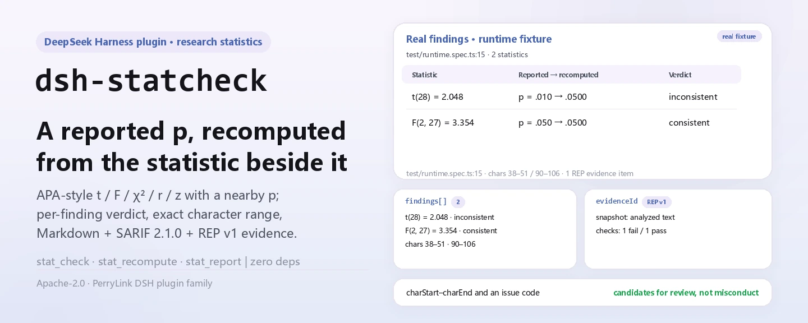
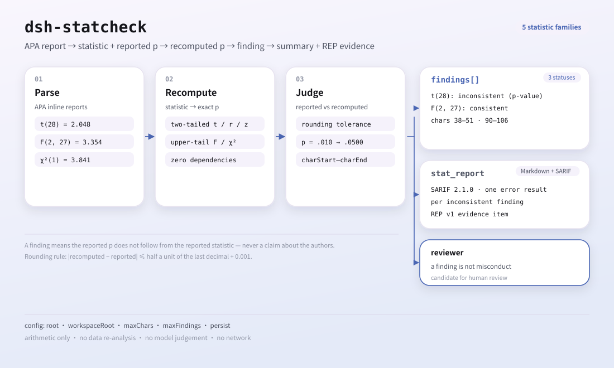
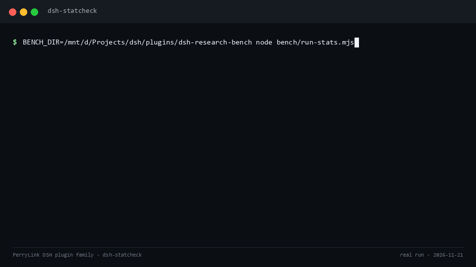

<div align="center">

<picture>
  <source media="(prefers-color-scheme: dark)" srcset="docs/assets/dsh-statcheck-hero-en-dark.webp">
  
</picture>

# dsh-statcheck

**Recalcula as estatísticas que um manuscrito relata — e sinaliza as que não fecham.**

*É aritmética, não acusação: cada achado mostra a estatística relatada, o valor p que ela realmente implica e os caracteres exatos de onde veio.*

[English](README.md) · [简体中文](README-zh.md) · [Español](README-es.md) · [Português](README-pt.md) · [हिन्दी](README-hi.md)

[](LICENSE)
[]()

</div>

---

## O que faz

- Analisa relatos no estilo APA: `t(df)`, `F(df1, df2)`, `χ²(df)`, `r(df)`, `z`, cada um com um `p = …`, `p < …` ou `p > …` próximo e um `95% CI [lo, hi]` opcional.
- Recalcula o valor p a partir da estatística relatada com distribuições sem dependências (t/r/z bicaudais, F/χ² de cauda superior).
- Sinaliza a autocontradição com o valor relatado, o valor recalculado, o intervalo de caracteres e um código de ocorrência estável.
- Confere o CI contra a significância (um p significativo com CI que inclui 0 é uma contradição).
- Emite Markdown e **SARIF 2.1.0**, e registra o texto analisado como um item de evidência REP v1 cujas verificações são os achados.


<picture>
  <source media="(prefers-color-scheme: dark)" srcset="docs/assets/dsh-statcheck-flow-v5-dark.svg">
  
</picture>

*Estrutura: analisar → recalcular → julgar; `findings[]` e `summary` são as duas saídas, e `stat_report` as renderiza como Markdown e SARIF 2.1.0. Os rótulos de token dentro do diagrama são os nomes reais de ferramentas, verificações e ocorrências, então a mesma imagem serve aos cinco idiomas.*

## O que não faz

- **Sem reanálise de dados.** Não é possível saber se a estatística relatada é apropriada para o desenho do estudo.
- **Sem acusações de má conduta.** Um achado significa “o p relatado não decorre da estatística relatada”. É um candidato à revisão humana, nunca um veredito sobre os autores.
- **Sem PDF/OCR.** Extraia o texto primeiro (`dsh-doc-anchor`) e passe `text` ou um caminho `.txt/.md/.tex/.html`.
- **Sem verificações de modelo ou pressupostos**, sem correção para comparações múltiplas, sem inferência de tamanho de amostra.
- **Sem ampliação silenciosa da tolerância.** A regra de arredondamento é fixa e documentada; um valor sinalizado continua sinalizado.

## Compatibilidade

| | |
|---|---|
| DeepSeek Harness | **`dsh-v0.2.2-rc.4`** (verificado em 2026-11-18); linha peer `>=0.2.1-0 <0.3.0 \|\| >=0.2.2-0 <0.3.0` |
| Node | `^22.19.0 \|\| >=24.9.0` (testado em `24.22.1`), somente ESM |
| Peers | `@perrylink/dsh-research-core ^0.1.0`, `@deepseek-ai/cordis ^4.0.5-alpha.1`, `@deepseek-ai/dsh-tools`, `@deepseek-ai/schemastery ^3.18.5-alpha.1` |
| Dependências em tempo de execução | **zero** |

```sh
dsh plugin --profile <name> add @perrylink/dsh-research-core dsh-statcheck
dsh --profile <name> --dump-config | grep dsh-statcheck
dsh plugin --profile <name> remove dsh-statcheck
```

## Ferramentas

### `stat_check`

`{ text?, path?, persist?, maxFindings? }` → `{ ok, summary, findings[], source, evidenceId?, recordPath? }`.

Cada achado: `statistic`, `df`, `text`, `charStart`, `charEnd`, `reported { statistic, p, pKind, pValue, ci? }`, `recomputed { p }`, `status` (`consistent`/`inconsistent`/`unparsed`), `issue?` (`p-value`/`p-threshold`/`ci`/`format`/`df`), `severity`, `detail`.

### `stat_recompute`

`{ statistic: 't'|'F'|'chi2'|'r'|'z', value, df[], p? }` → `{ ok, p, judgment? }`.
t/r/z são bicaudais; F/χ² de cauda superior. `p` usa a mesma regra de arredondamento de `stat_check`.

### `stat_report`

`{ findings, text? }` → `{ ok, markdown, sarif, summary }`. O SARIF leva um resultado de erro por achado inconsistente. Passe o texto original do manuscrito para mapear o `charStart` de cada achado a um `startLine`/`startColumn` real do SARIF; sem `text`, a região cai na linha 1 mais uma coluna de caractere (as propriedades `charStart`/`charEnd` são sempre exatas).

### Códigos de erro

`INVALID_INPUT` · `NOT_FOUND` · `PATH_ESCAPE` · `NOT_A_FILE` · `TOO_LARGE` · `OUT_OF_DOMAIN` · `STORE_ERROR`

## A regra de arredondamento (documentada, não ajustada)

Um `p = x` relatado é consistente quando `|recalculado − x| ≤ 0.5 × 10^-decimais + 0.001`.
O `0.001` extra absorve o fato de que a própria estatística costuma ser relatada arredondada (por exemplo, `t = 2.50` implica p ≈ .01855, normalmente escrito `.019`). `p < X` é consistente quando o valor recalculado fica abaixo de `X`; `p > X` quando fica acima.

## Configuração

| Chave | Padrão | Significado |
|---|---|---|
| `enabled` | `true` | `false` não monta nada |
| `root` | `.statcheck` | raiz do armazenamento e dos registros |
| `workspaceRoot` | `process.cwd()` | os caminhos de manuscritos devem resolver dentro dela |
| `maxChars` | `2000000` | limite de caracteres analisados (acima disso falha, nunca trunca) |
| `maxFindings` | `500` | achados por chamada |
| `persist` | `true` | grava um snapshot e um registro REP |

## Avaliação



*Animado: a saída real por stdout do adaptador de benchmark sobre os 30 casos de estatística congelados (`node bench/run-stats.mjs` com `BENCH_DIR` apontando para o checkout congelado de `dsh-research-bench`, sem rede; reexecutado em 2026-11-21). As pontuações perfeitas descrevem apenas estes casos construídos em torno de valores críticos — o aviso de escopo abaixo continua valendo.*


### Benchmark — `dsh-research-bench` stats v0.1.0 (30 casos)

```sh
pnpm run bench:stats
```

| métrica | valor |
|---|---:|
| precision de inconsistência | **1.00** |
| recall de inconsistência | **1.00** |
| F1 de inconsistência | **1.00** |
| taxa de falsos positivos em amostras limpas | **0.00** |
| exatidão da ocorrência quando sinalizada | **1.00** |
| exatidão global | **1.00** |

Predições brutas por caso: [`bench/results-stats.json`](bench/results-stats.json).

**Aviso de escopo**: o conjunto de dados é pequeno, sintético e limpo (10 frases consistentes + 20 inconsistentes construídas em torno de valores críticos publicados). Uma pontuação perfeita mostra que o analisador e o recálculo concordam com os rótulos de valor crítico nestas construções; **não** estima a exatidão em manuscritos reais. A regra de arredondamento e os códigos de ocorrência estão documentados para que o leitor possa discordar de um achado específico.

### Testes

- **43 testes em 6 arquivos**: caudas de distribuição contra valores críticos publicados (t/F/χ²/r/z), análise (todas as famílias, deslocamentos, limiares, CIs, várias estatísticas, não analisado), julgamento (p-value, limiar, formato, CI, df, domínios negativos de F/χ²), runtime (evidência + registro REP válido, reverificação sem conflito de evidência, limite de achados, tipo de arquivo/mídia, persist=false, escapes de caminho, limite de tamanho), ferramentas (esquemas, sucesso/falha, SARIF incl. um p recalculado nulo e o mapeamento de linha/coluna a partir do texto opcional) e contrato do pacote.

## Limitações conhecidas (v0.1)

- Não são modelados testes unicaudais, df fracionários de Welch, tabelas multi-modelo nem referências dentro do texto como “ver Tabela 2”.
- Apenas relatos APA em linha são analisados; valores `p` em tabelas ficam fora do escopo.
- A verificação de CI contra p assume um teste bicaudal do mesmo efeito com α = .05.
- Sem correção para comparações múltiplas.
- O mapeamento de linha/coluna do SARIF precisa do `text` opcional de `stat_report`; sem ele, a região é linha 1 + coluna de caractere (as propriedades exatas `charStart`/`charEnd` sempre estão presentes).

## Licença

Apache-2.0. Nenhum código de terceiros em tempo de execução.
